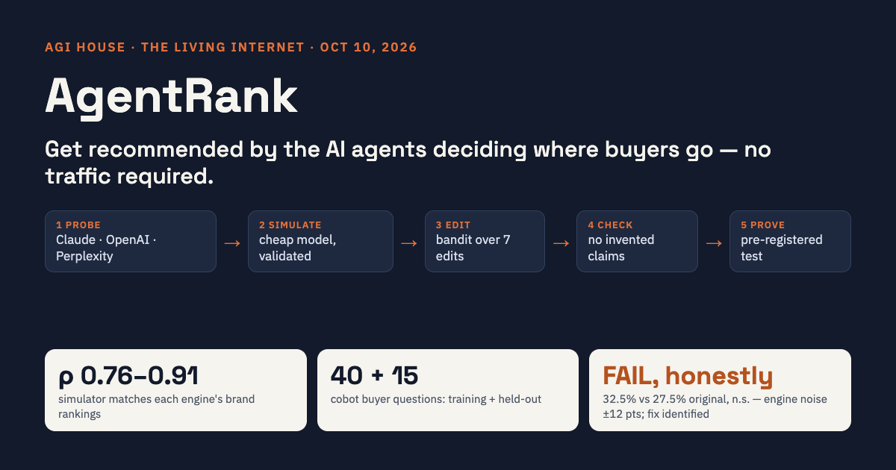

# AgentRank

**Get recommended by the AI agents deciding where buyers go, without needing any traffic.**

Built in one day, solo, at the AGI House *Living Internet* build day (Oct 10, 2026).
[Website & demo](https://bouncypitch.github.io/agent-rank/) · [Demo video](docs/AgentRank_demo.mp4) · [Pre-registration](PREREGISTRATION.md)



## The idea
Buyers now ask ChatGPT, Claude or Perplexity *"which cobot should I buy for welding?"*, and the answer names three brands. Tools like Coframe optimize a site by learning from its own visitors, but a cobot startup with a few hundred visits a month doesn't have enough traffic for that.

AgentRank learns from what the engines **already recommend** instead:

1. **Probe:** ask the real engines (Claude Opus 5.5, OpenAI gpt-5.5, Perplexity) buyer questions many times. Record which pages they read and which brands they name.
2. **Simulate:** a cheap model (Claude Haiku 5.5) answers from the same pages. It is validated against the real engines.
3. **Edit:** a Thompson-sampling bandit picks one of 7 edit types (answer first, specs table, use-case sections, customer evidence, price signal, specificity, buyer FAQ). An LLM applies it using only facts already on the page.
4. **Check:** a claim checker rejects any edit that adds an unsupported claim. Restructuring is allowed; invention is not.
5. **Prove:** a pre-registered head-to-head on the real engine, on held-out questions, against a generic AI rewrite and a placebo edit.

## Results, reported as measured

| What | Result |
|---|---|
| Simulator vs. real engines, brand rankings (Spearman ρ) | Perplexity 0.81 · OpenAI 0.91 · Claude 0.76 |
| Simulator vs. real engines, single question × brand (r) | 0.25 · 0.42 · 0.09. Too noisy to trust per question, which also applies to the engines themselves (Perplexity vs. itself: 0.21) |
| **Pre-registered final test** (Claude Opus 5.5, 5 companies × 8 held-out questions × 4 versions) | **FAIL.** Original 27.5% · generic rewrite 35.0% · placebo 30.0% · optimized 32.5%. Optimized vs. original +5.0 pts, p = 0.54 (Holm) |

**Why it failed:** the same unchanged page, asked twice, scored 50% vs. 38% and 25% vs. 38%. Simulated gains from 16 runs per edit sat inside that noise, so the optimizer kept edits that got lucky. **Next:** many more simulator runs per edit, more questions, and more trials in the final test.

## Keeping it honest
- Hypothesis, metric and analysis committed before the test: `f7a0b9f`. Targets locked: `eee5a57`. Amendments, each committed before the data they apply to was seen: `0e88e8e`, `e70b303`.
- 15 held-out questions were never used for learning.
- The same content is served to humans and bots. No hidden text, no prompt injection.
- The checker was tuned twice on training data, and both earlier versions are documented in the git log. v1 truncated verdicts; v2 rejected harmless restructuring.

## Run it
```bash
uv venv -p 3.11 .venv && uv pip install -p .venv -r requirements.txt
cp .env.example .env   # add ANTHROPIC_API_KEY, OPENAI_API_KEY, PERPLEXITY_API_KEY
.venv/bin/python -m agentrank.probe --engines perplexity --samples 3     # 1. probe
.venv/bin/python -m agentrank.validate --engine perplexity              # 2. simulator go/no-go
.venv/bin/python -m agentrank.run_optimize --start 0 --count 10         # 3–4. optimize
.venv/bin/python -m agentrank.final_eval && .venv/bin/python -m agentrank.analyze   # 5. prove
```
Every paid call is cached in `runs/cache.sqlite`, and a hard spending cap (`SPEND_CAP_USD`) stops runs before they overspend. This run cost about $35.

## Layout
```
agentrank/   engines/ (claude, openai, perplexity) · probe · simulator · validate · optimizer (bandit + checker)
             baselines · final_eval · analyze · export_public · demo_page
data/        queries.json (train / held-out) · brands.json · targets.json
runs/public/ summary.json: every number shown, no third-party page text
docs/        the website, video and thumbnail (GitHub Pages)
video/       narration script and the render pipeline (frames + ElevenLabs/say + ffmpeg)
```

## Note on data
The companies' web pages, and the rewritten versions of them, are not published here. The repo and the site show numbers only. Company names are used solely to report measurements.

> **About the commit hashes:** before publishing, the history was rewritten to remove third-party page text, which changed every hash. Commit timestamps and contents are unchanged. Earlier drafts cited the old hashes: 583b63e→f7a0b9f, 1cd568d→eee5a57, 5aededd→0e88e8e, 4002ebd→e70b303.
